# ClearAir

ClearAir is a family air-quality copilot for PromptWars Challenge 6. It combines live Open-Meteo data with a deterministic household decision engine, then optionally uses a grounded Gemini-first AI chain to explain the resulting plan.

## Chosen vertical

> Create a GenAI-powered assistant that helps families and communities navigate severe winter smog and urban air pollution. The application should suggest low-emission daily routines, indoor air quality hacks, and sustainable alternatives tailored to their location and lifestyle, while clearly explaining the direct impact of their choices.

The chosen vertical is a family and community winter-smog assistant. ClearAir is intentionally usable without an AI key: computed facts and the deterministic briefing remain available when every AI provider is unavailable.

## Approach and logic

The decision engine in `src/lib/decision-engine.ts` is pure orchestration over the domain modules in `src/lib/`. Gemini does not make AQI, health-risk, window, routine, hack, emissions, or exposure decisions; it only narrates the validated result.

- `src/lib/aqi.ts` implements the EPA US AQI bands and piecewise interpolation formula `I = ((Ihi - Ilo) / (Chi - Clo)) × (C - Clo) + Ilo` for PM2.5 and PM10. The band lookup handles AQI 0 and values above 500.
- `src/lib/profile.ts` maps the EPA band to a baseline risk tier, then elevates it for children, older adults, pregnancy, respiratory/cardiac conditions, and outdoor workers.
- `src/lib/forecast.ts` searches contiguous forecast hours for the lowest mean AQI and annotates the first 24 hours. The annotation uses sequence positions, so a clean window crossing midnight is retained.
- `src/lib/routine.ts` creates five timed segments for inversion, the computed clean window, afternoon shielding, evening traffic, and night-time clean-room protection.
- `src/lib/hacks.ts` ranks a small evidence-based catalog against household equipment, fuels, housing, vulnerability, and AQI.
- `src/lib/impact.ts` is the single source of named model constants. Weekly commute impact is `round-trip km × 5 days × (current factor - alternative factor)`. Cooking impact is `(current indoor PM2.5 - induction PM2.5) / current indoor PM2.5 × 100`. Solid-heating PM impact is `grams/hour × 6 hours/day × 7 days`.
- Exposure impact weights 21 indoor hours and 3 outdoor hours using the infiltration constants, a 15 m³/day inhalation volume, and a fitted-respirator transmission factor. Results are estimates, not medical measurements.

## How it works

```mermaid
flowchart LR
    B[Browser: location + household profile] --> P[POST /api/plan]
    P --> V[Zod request validation]
    V --> O[Open-Meteo air API]
    O --> C[10-minute bounded LRU + in-flight dedupe]
    C --> E[Deterministic decision engine]
    E --> U[Daily briefing UI]
    U --> A[POST /api/briefing or /api/chat]
    A --> AV[Zod plan/context validation]
    AV --> AI[AI provider orchestrator]
    AI --> G[Gemini model chain]
    G -->|failure| Q[Groq model chain, if configured]
    G -->|success| N[Grounded AI narration]
    Q -->|success| N
    AI -->|no provider or all failures| F[Deterministic multilingual fallback]
    N --> U
    F --> U
```



The browser sends a validated location/profile to `/api/plan`. The server fetches current pollutants and a two-day hourly forecast from Open-Meteo, validates that upstream response, caches it by rounded coordinates, and computes the plan. Briefing and chat are explicit user actions. Their routes validate the whole plan and profile again, put facts inside `<household_facts>`, delimit user text as untrusted data, and cap provider output at 1200 tokens so reasoning-capable models have room to answer. The orchestrator in `src/lib/ai/orchestrator.ts` tries Gemini's configured model plus verified fallbacks first; if that chain fails and `GROQ_API_KEY` is set, it tries Groq using its configured model, `openai/gpt-oss-120b`, and `qwen/qwen3.8-27b`. Groq requests use low reasoning effort and suppress the reasoning trace where the model supports it. Both providers receive the same system grounding instruction and prompt. A missing key or exhausted provider chain returns a deterministic response instead. Provider/model successes are logged server-side; the API exposes only `source: "ai"` or `source: "fallback"`.

### AI provider architecture

`src/lib/ai/types.ts` defines the typed `TextProvider` contract. `src/lib/ai/gemini.ts` and `src/lib/ai/groq.ts` implement provider-specific SDK/fetch behavior, shared timeout and output-budget rules, and model failover. `src/lib/ai/orchestrator.ts` walks configured providers in the fixed order Gemini → Groq and logs the successful provider/model without credentials. The routes do not need to know which provider answered, so the user-facing response contract remains stable.

Data sources are Open-Meteo Geocoding and Air Quality APIs (keyless), EPA AQI breakpoints in `src/lib/aqi.ts`, and the named source assumptions documented beside constants in `src/lib/impact.ts` and `src/lib/hacks.ts`.

## Problem-statement traceability

| Brief clause | Implemented feature | Primary files |
| --- | --- | --- |
| GenAI-powered assistant | Gemini → Groq server providers, grounded prompts, five languages, fallback narration | `src/lib/ai/`, `src/lib/prompt.ts`, `src/app/api/briefing/route.ts` |
| Families and communities | Optional household profile and member-specific AQI risk guidance | `src/components/ProfileForm.tsx`, `src/lib/profile.ts` |
| Severe winter smog and urban pollution | Live AQI, PM2.5, PM10, NO2, O3, CO, and 48-hour forecast | `src/lib/open-meteo.ts`, `src/components/AqiHero.tsx`, `src/components/ForecastStrip.tsx` |
| Low-emission daily routines | Timed ventilation, errands, commute, shielding, and clean-bedroom routine | `src/lib/routine.ts`, `src/components/DailyRoutine.tsx` |
| Indoor air-quality hacks | Household-ranked filtration, ventilation, cooking, sealing, cleaning, and respirator actions | `src/lib/hacks.ts`, `src/components/RankedHacks.tsx` |
| Sustainable alternatives tailored to lifestyle | Commute, cooking-fuel, and solid-heating alternatives with weekly CO2/PM2.5 estimates | `src/lib/impact.ts`, `src/components/AlternativesList.tsx` |
| Clearly explain direct impact of choices | Baseline/optimized inhaled dose and per-intervention exposure factors | `src/lib/impact.ts`, `src/components/ExposureImpactCard.tsx` |
| Location and browser geolocation | City search plus browser geolocation with Permissions-Policy restriction | `src/components/LocationPicker.tsx`, `src/app/api/locations/route.ts`, `next.config.ts` |

## Security

- Every API query/body and every browser-supplied plan context is parsed with Zod. Open-Meteo JSON is schema-checked before use; malformed upstream data returns a uniform 502 envelope.
- JSON request bodies are capped at 64 KiB, API routes have per-IP sliding-window limits, and errors never echo stack traces or upstream messages.
- API responses include HSTS, `X-Content-Type-Options`, frame denial, a restrictive referrer policy, a geolocation-only Permissions-Policy, and an API CSP with no executable sources. Document headers are configured in `next.config.ts`.
- `GEMINI_API_KEY` and `GROQ_API_KEY` are read only in server code. They are absent from the client bundle and `.env.local` is ignored. User questions and chat history are delimited and treated as data by the shared model instruction.

## Efficiency

Open-Meteo responses use a 10-minute bounded LRU cache for air data and a one-hour cache for geocoding. Identical concurrent requests share one in-flight promise. Coordinates are rounded for cache keys, upstream requests have abort timeouts, and the AI chain is called only after a user clicks a briefing or sends a chat question. No UI library or binary asset is included.

## Accessibility

The app has a `lang="en"` document, a keyboard-focusable skip link, semantic landmarks, labelled fieldsets and controls, visible focus rings, live regions for async states, alert roles for errors, and a text-table alternative for the forecast strip. AQI always includes a numeric value, band words, and an icon; it is not conveyed by colour alone. The stylesheet supports dark/light `prefers-color-scheme` and `prefers-reduced-motion`. `tests/contrast.test.ts` checks the dark and light palette ratios.

## Testing

The final verification run produced:

| Command | Result |
| --- | --- |
| `npm run typecheck` | PASS |
| `npm run lint` | PASS, 0 warnings |
| `npm run test:coverage` | PASS, 282 tests in 19 files |
| Coverage | 97.95% statements, 91.98% branches, 98.54% functions, 98.15% lines |
| `npm run build` | PASS |
| `npm audit` | 0 vulnerabilities |

Coverage thresholds are configured in `vitest.config.ts` at 95% statements, 90% branches, 95% functions, and 95% lines. Tests cover engine boundaries and edge cases, cache expiration/deduplication, invalid inputs, malformed upstream responses, rate limits, Gemini success/failure/fallback, prompt injection delimiters, contrast, and route error envelopes.

## Assumptions and limits

- Open-Meteo is keyless and can be temporarily unavailable; ClearAir shows an error rather than inventing live readings.
- AQI is the US AQI representation supplied by Open-Meteo. The EPA breakpoint implementation is not a substitute for local public-health advice.
- Emission factors, indoor concentrations, infiltration factors, filter reductions, and time-activity weights are named estimates in `src/lib/impact.ts`. They describe scenario comparisons, not guarantees for a particular building, vehicle, stove, or person.
- The exposure model uses one adult-equivalent inhalation volume and does not diagnose, treat, or replace a clinician's advice. Families should follow local emergency guidance and prescribed treatment plans.
- Browser geolocation requires user permission and is only used to make the current location request; ClearAir does not store telemetry or tracking cookies.

## Run locally

```bash
npm ci
cp .env.example .env.local
npm run dev
```

The app is fully usable without Gemini or Groq keys. Run the production checks with:

```bash
npm run verify
npm run build
npm audit
```

## Environment variables

| Variable | Required | Description |
| --- | --- | --- |
| `GEMINI_API_KEY` | No | Server-only Google Gemini key. Blank skips Gemini. |
| `GEMINI_MODEL` | No | First Gemini model to try. If unset, the chain is `gemini-3.1-flash-lite` → `gemini-3.5-flash-lite`; unavailable models are skipped. |
| `GROQ_API_KEY` | No | Server-only Groq key. Blank skips the silent Groq backup. |
| `GROQ_MODEL` | No | First Groq model to try. If unset, the chain is `openai/gpt-oss-120b` → `qwen/qwen3.8-27b`; unavailable models are skipped. |
